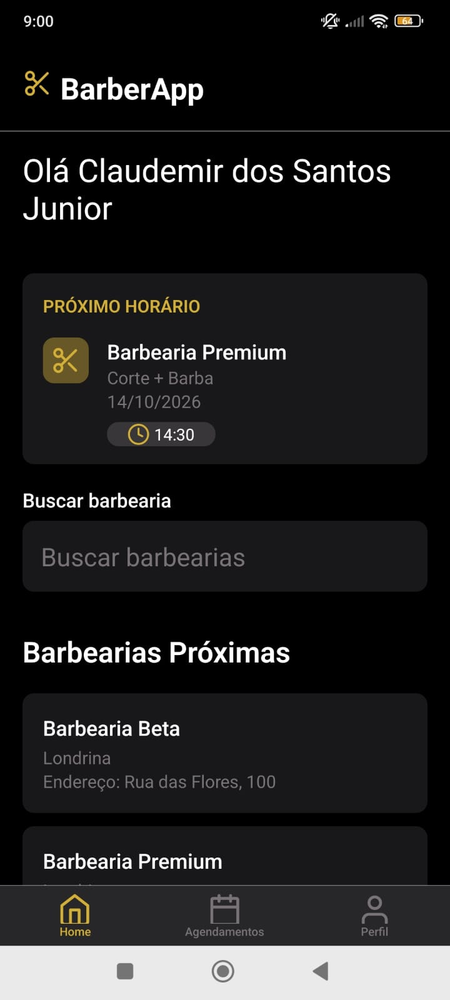
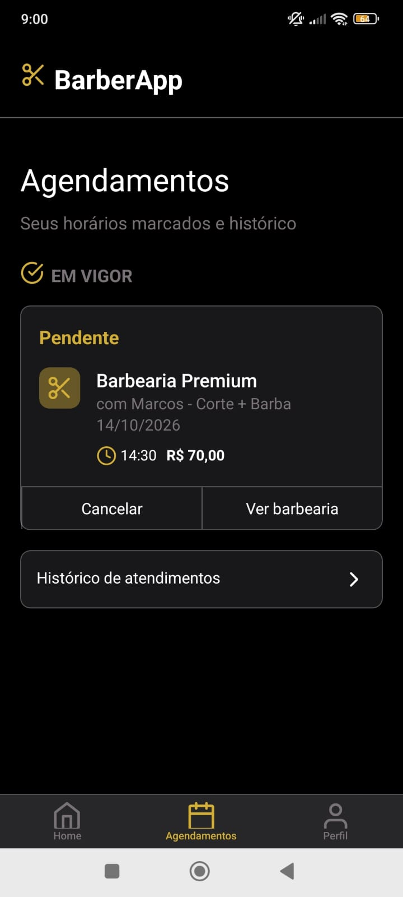
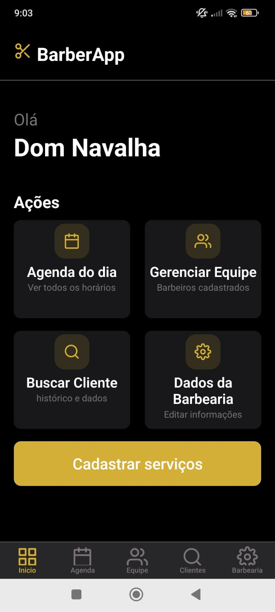
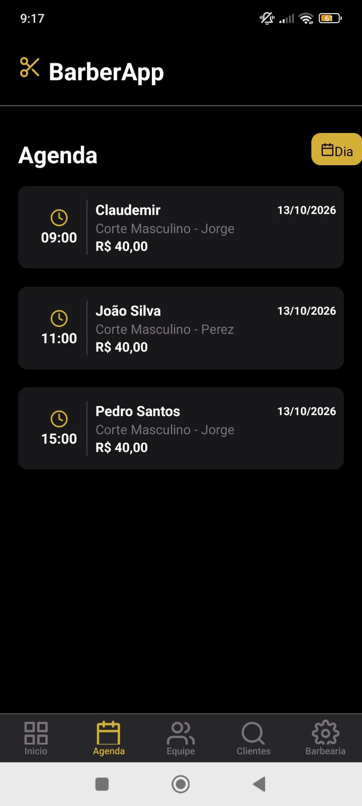
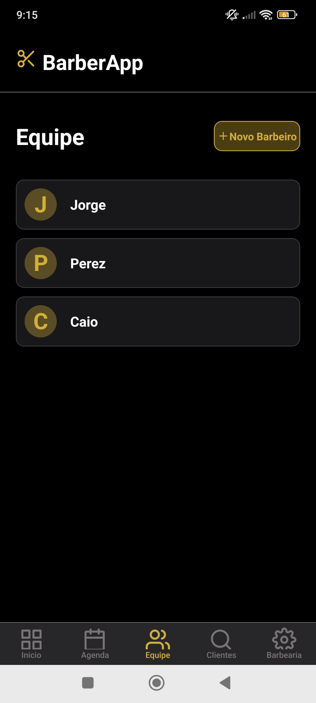
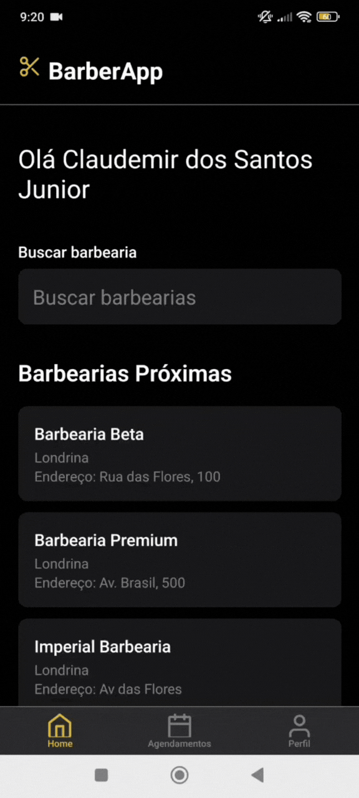

# BarberApp — Sistema de Agendamento para Barbearias

O BarberApp é um aplicativo mobile desenvolvido para facilitar o agendamento de serviços em barbearias e simplificar o gerenciamento do negócio. A aplicação possui dois perfis de acesso: cliente e proprietário da barbearia (*owner*), cada um com funcionalidades específicas.

O projeto foi desenvolvido com **React Native, Expo, Node.js, Express e MySQL**, com foco na integração entre frontend e backend, autenticação de usuários, gerenciamento de dados e comunicação com o cliente.

## 📱 Demonstração do projeto

O BarberApp conta com interfaces específicas para clientes e proprietários de barbearias.
### Página inicial


### Painel do cliente

<!-- Substitua os caminhos abaixo pelos nomes reais das suas imagens. -->




### Painel do proprietário (Owner)





### Vídeo de demonstração




## ✨ Funcionalidades

### 👤 Cliente

- Cadastro e autenticação de usuários.
- Login com autenticação baseada em JWT.
- Pesquisa e consulta de informações das barbearias.
- Visualização dos serviços oferecidos e dos profissionais disponíveis.
- Seleção de profissional, data e horário para agendamento.
- Consulta aos agendamentos e ao histórico de reservas.
- Recebimento de e-mail de confirmação após o agendamento.

### 💼 Proprietário da barbearia (Owner)

- Acesso às funcionalidades administrativas da própria barbearia.
- Consulta e gerenciamento de informações da barbearia.
- Gerenciamento de serviços e profissionais.
- Configuração dos horários de funcionamento, incluindo regras para sábados e domingos.
- Consulta aos agendamentos recebidos.

### 📅 Gerenciamento de agendamentos

- Consulta de horários disponíveis conforme a data, o profissional e a disponibilidade da barbearia.
- Consideração dos horários de funcionamento e dos agendamentos existentes.
- Organização das reservas por data e horário.
- Envio de e-mail de confirmação do agendamento.

## 🛠️ Tecnologias utilizadas

### Frontend
- **React Native** — desenvolvimento da interface mobile.
- **Expo** — ambiente e ferramentas para desenvolvimento do aplicativo.
- **React Navigation** — navegação entre telas.
- **Expo SecureStore** — armazenamento seguro do token de autenticação no dispositivo.
- **Fetch API** — comunicação com o backend.

### Backend
- **Node.js** — ambiente de execução JavaScript.
- **Express** — criação da API REST.
- **JWT (JSON Web Token)** — autenticação e validação de acesso.
- **bcrypt** — proteção de senhas por hash.
- **Nodemailer** — envio de e-mails de confirmação de agendamento.
- **dotenv** — gerenciamento de variáveis de ambiente.

### Banco de dados
- **MySQL** — armazenamento e gerenciamento dos dados relacionais da aplicação.

## 🔐 Segurança e autenticação

O projeto utiliza JWT para autenticar as requisições protegidas da API e bcrypt para armazenar senhas de forma segura, evitando o armazenamento de senhas em texto puro.

No aplicativo mobile, o token de autenticação é armazenado com o Expo SecureStore e utilizado nas requisições que exigem autorização.

As credenciais e configurações sensíveis são mantidas em variáveis de ambiente, evitando sua exposição direta no código-fonte.

## 🗄️ Banco de dados

O banco de dados relacional organiza as informações necessárias para o funcionamento da aplicação, incluindo usuários, barbearias, profissionais, serviços, horários de funcionamento e agendamentos.

Entre as principais entidades estão:

- `users` — usuários e clientes cadastrados.
- `barbershops` — barbearias e seus proprietários.
- `business_hours` — horários de funcionamento.
- `appointments` — agendamentos realizados.

O modelo também contempla as entidades relacionadas aos serviços e aos profissionais, permitindo associar cada reserva à barbearia, ao serviço, ao profissional e ao cliente correspondentes.

## 🚀 Como executar o projeto

### Pré-requisitos

- Node.js e npm instalados.
- MySQL instalado e em execução.
- Expo Go ou um ambiente de emulação compatível com React Native.
- Banco de dados configurado para a aplicação.

### 1. Clone o repositório

```bash
git clone <URL_DO_REPOSITORIO>
cd BarberApp
```

### 2. Configure o backend

Entre na pasta do backend e instale as dependências:

```bash
cd Backend
npm install
```

Configure o arquivo `.env` com as credenciais do banco de dados, o segredo JWT e as informações necessárias para o serviço de e-mail, utilizando os nomes de variáveis esperados pelo código da aplicação.

Crie o banco de dados MySQL e execute o script SQL de criação das tabelas, caso ele esteja disponibilizado no repositório.

Inicie o servidor utilizando o comando configurado no `package.json` do backend.

### 3. Configure o frontend

Em outro terminal, acesse a pasta do frontend:

```bash
cd Frontend
npm install
```

Configure a URL da API para apontar para o endereço acessível pelo dispositivo ou emulador.

Inicie o projeto utilizando o script do Expo definido no `package.json` do frontend.

> **Observação:** os comandos, caminhos, scripts e variáveis de ambiente devem corresponder à estrutura e às configurações reais do repositório.

## 📚 Aprendizados e objetivos do projeto

O desenvolvimento do BarberApp permitiu aplicar conhecimentos de desenvolvimento mobile e backend, incluindo:

- Construção de uma API REST com Node.js e Express.
- Integração entre React Native e uma API própria.
- Modelagem de banco de dados relacional com MySQL.
- Autenticação e autorização com JWT.
- Proteção de senhas com bcrypt.
- Armazenamento de credenciais no dispositivo com SecureStore.
- Implementação de regras de negócio para agendamentos e disponibilidade de horários.
- Envio de e-mails utilizando Nodemailer.
- Separação de funcionalidades de acordo com o perfil de acesso.

## 🔮 Melhorias futuras

- Implementação de lembretes automáticos de agendamento pelo WhatsApp.
- Aprimoramento dos relatórios e das estatísticas de agendamentos.
- Expansão dos recursos administrativos e da experiência do usuário.

## 👨‍💻 Autor

**Claudemir Junior**

Desenvolvedor em formação, com foco em desenvolvimento backend e aplicações mobile.


---

*BarberApp — conectando clientes e barbearias por meio de uma experiência de agendamento simples e organizada.*